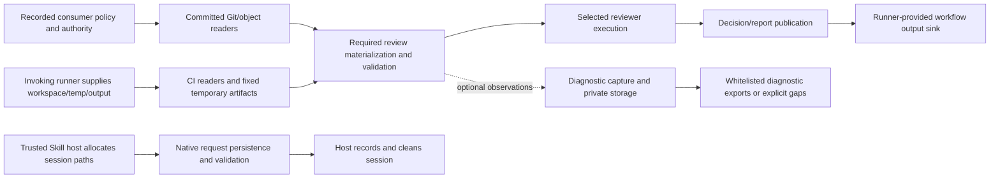

# Initial Git/filesystem implementation inventory for #573

This is the first, non-normative inventory outcome for
[#573](https://github.com/flair-agency/architecture-gatekeeper/issues/573), not
an API/library selection, extraction, security assessment or whole-issue
completion. The merged baseline is
`f2698baff3e6d43ba696ca1fe6783ab6d25b3c49` after #595. Its `src/` and `scripts/`
are byte-identical to the scanned source at reviewed `217d437` and adopted
`7f41f88`; only documentation changed between those checkpoints.

## Method and coverage

The retained source list covers tracked `.mts`/`.mjs` under `src/` and
`scripts/`. A TypeScript AST inspection identifies import declarations and
literal `import()`/`require()` for `node:fs`, `node:fs/promises`,
`node:child_process` and their bare spellings, separating type-only declarations.
It observes direct calls through named/default/namespace imported bindings.
The table below is an import/call inventory, not proof of all transitive I/O.
Names passed into injected adapters, computed imports, dependency internals,
process streams and inline workflow commands need separate inspection.

There are **58 source files** with matching declarations: **57 have runtime
imports**, and `src/github/github-cli-runner.mts` has type-only imports only.
The source has **75 matching import declarations: 73 runtime and two type-only**.
There are **15 script files / 21 runtime declarations**. These counts are not
resource-boundary counts: direct-run guards, injected collaborators and real
acquisition/publication have different responsibilities. A missing direct-call
entry does not establish absence of I/O. Earlier text-match counts are not used.

All six selected canonical members were read for this inventory; their unchanged
identities are recorded below. A candidate's separate Native review result
belongs to its PR verification, not this static scan. Selected authority governs
new responsibilities. This implementation map cannot change it.

## Existing responsibility and data flows

The diagram records current data flow. Diagnostic results have no acceptance
edge; publication does not authenticate the host or authorize a merge.

| Family | Producer → consumer and binding | Acquisition/write and cleanup ownership | Failure semantics and reuse boundary |
| --- | --- | --- | --- |
| G: committed Git inputs | Recorded revision/path and selected policy/authority → materialization, review context and governance consumers. Readers verify different object/mode/path properties. | Caller selects root and exact revisions; readers own command execution and byte acquisition. Returned bytes belong to the caller; materialization lifetime is separate. | Required input failure rejects preparation. Shared Git syntax alone is insufficient equivalence: mode acceptance, replacement/config handling, size checks, deadlines and errors differ. |
| R: required prepared files/workspaces | Selected authority, prompt/schema/provenance and exact base/head/reviewed tuple → reviewer and validators. | Preparation owns its documented outputs; workspace creation and returned cleanup/caller cleanup follow each API. Do not infer cleanup of every output from a temporary path. | Required malformed/missing/over-limit data fails closed. Preserve exact bytes, decode order, aggregate limits, output protocol and identities; do not import optional diagnostic allowlists. |
| N: native sessions | Original host-supplied session request/decision paths → native adapter and shared validator. | Skill host allocates private directory, records exact bytes and cleans all session paths. Native adapter constructs/persists request and validates decision. | Failure leaves review incomplete. Exclusive creation/modes do not attest parent privacy or same-user isolation. #566's stream/persistence transfer is not selected. |
| C/O: CI temporary artifacts and publication | Invoker's original workspace/temp/sink and selected producer inputs → CI preparation/reporting. | Fixed runner-temp table owns internal artifact locations. `appendGitHubOutput` reads the runner's actual sink; it is not required below `RUNNER_TEMP`. Other native appenders remain inventoried separately. | Required publication errors remain errors. Internal filenames, actual output sink and general caller paths are distinct contracts; do not restore arbitrary internal artifact destinations or treat all appenders as equivalent. |
| P/L: provider execution and local Hook state | Revision-bound request/workspace and selected settings → execution adapter; local snapshots/state → local feedback. | Adapter owns its child transport/temp data according to the current API; Hook state/locking and host lifecycle differ from native session ownership. | Execution failure is incomplete, not semantic PASS/BLOCK. Keep existing deadline, cancellation, credential and state behavior; similar subprocess APIs do not establish identical lifecycle guarantees. |
| D: diagnostics | Opt-in captured metadata/private observations → local/job storage, reconciliation and whitelisted export. | Consumer owns private location/access/retention/export. `diagnostic-path` enforces its own host-root, parent/descriptor, bounded-read and decoding rules. | Optional integration failures remain gaps and cannot fail/satisfy required review. An explicitly invoked diagnostic CLI can fail its own command. Do not spread these storage rules to required/native paths or silently expose captured metadata. |
| V/H: preview and host readback | Exact recorded Git/procedure/runtime or host observations → preview/finalizer/readback consumers. | Route-specific acquisition/materialization and API caller own their lifetime. | Preserve preview UNVERIFIED/observed meanings and readback-vs-eligibility separation. Local/fixture readback is not live host enforcement. |
| T: development/release/probe scripts | Repository/build/analysis/probe inputs → their own tool outcome. | Each tool owns its output/archive/cache/probe resources. | A tool error is not a semantic decision. Do not apply a review-route filesystem policy merely because the script also imports `fs`. |

## Contract differences that prevent automatic consolidation

| Mechanism | Concrete current difference | Disposition before choosing a shared API |
| --- | --- | --- |
| `authority-set.readCommittedAuthorityFile` versus `legacy-git-snapshot.readRegularGitSnapshot` | The former verifies commit/tree/blob type and declared object size, then bounded bytes, with a 10s per-command maximum that optional remaining time can narrow. The latter accepts regular100644/100755 entries, uses a 2,000,000-byte subprocess buffer and checks caller maxBytes after acquisition; its helper has no explicit timeout option. | Compare accepted modes, paths, identities, deadlines, post-read behavior and callers first. A shared implementation must not silently strengthen/weaken either public contract. No equivalence is established here. |
| Required context/snapshot Git versus optional measurement Git | Context binds exact ordered merge parents and complete diff; diagnostics may acquire selected runtime/input metadata under separate optional budgets and report unknown facts. | Preserve capture/repository/revision provenance and required-vs-optional errors. Reuse already captured metadata only when those meanings match; otherwise retain explicit gaps. |
| Descriptor-based diagnostic read versus authority manifest read versus native decision read | `diagnostic-path` applies its own host-root/link/descriptor/actual-byte/strict-decoding checks; authority preparation has its own regular-file/byte/depth rules; native paths remain host-managed. | Factor a byte-reading mechanism only after caller preconditions and rejection semantics are mapped. A generic path sanitizer, universal allowlist or common destination owner is not selected. |
| Internal CI file write versus workflow output versus provider/local state | Fixed filenames and overwrite rules, runner-created append-only command output, and adapter-created response/lock/state files have different producers and lifetimes. | Keep destination validation, open flags, truncation/publication ordering and cleanup with the correct owner; do not infer transactional or race-free behavior. |
| Git/gh process runner versus model process supervision | Some command runners are injected and synchronous; provider processes carry separate settings, credentials, stdio and termination semantics. | A value/command helper alone must not hide execution authority, deadlines or incomplete outcomes. No universal runner API is selected. |

## Complete direct-import surface at this baseline

Each row is retained for contract review, rather than automatically migrated.
The family labels refer to the responsibilities above. Calls are static observed
uses of imported bindings; callbacks passed as values and delegated I/O are not
expanded into the direct-call column. CLI `realpathSync` checks may only preserve
compatibility dispatch, while the CLI still delegates other work.

| Authored file | Native imports | Observed direct calls | Family/disposition |
| --- | --- | --- | --- |
| [`scripts/check-source-cycles.mjs`](../../scripts/check-source-cycles.mjs) | fs/promises | lstat, readFile, readdir, realpath | T; tool/probe/build |
| [`scripts/clean-dist.mjs`](../../scripts/clean-dist.mjs) | fs | lstatSync, readdirSync, rmSync | T; tool/probe/build |
| [`scripts/codeql-local.mjs`](../../scripts/codeql-local.mjs) | child_process, fs | existsSync, mkdirSync, mkdtempSync, readFileSync, realpathSync, spawnSync, writeFileSync | T; tool/probe/build |
| [`scripts/codeql-model-regression.mjs`](../../scripts/codeql-model-regression.mjs) | fs | cpSync, readFileSync, writeFileSync | T; tool/probe/build |
| [`scripts/issue83-block-record-probe.mjs`](../../scripts/issue83-block-record-probe.mjs) | fs | readFileSync, writeFileSync | T; tool/probe/build |
| [`scripts/issue83-offline-block-verifier.mjs`](../../scripts/issue83-offline-block-verifier.mjs) | child_process, fs | closeSync, execFileSync, fstatSync, mkdtempSync, openSync, readSync, realpathSync, rmSync, writeFileSync | T; tool/probe/build |
| [`scripts/issue83-real-pr-block-probe.mjs`](../../scripts/issue83-real-pr-block-probe.mjs) | child_process, fs | execFileSync, readFileSync, writeFileSync | T; tool/probe/build |
| [`scripts/owner-amendment-attempt-classifier.mjs`](../../scripts/owner-amendment-attempt-classifier.mjs) | child_process | execFileSync | G/R/C/O; producer/receiver |
| [`scripts/owner-amendment-block-producer.mjs`](../../scripts/owner-amendment-block-producer.mjs) | child_process, fs | execFileSync, readFileSync, writeFileSync | G/R/C/O; producer/receiver |
| [`scripts/owner-amendment-merge-group-gate.mjs`](../../scripts/owner-amendment-merge-group-gate.mjs) | child_process | execFileSync | G/R/C/O; producer/receiver |
| [`scripts/owner-amendment-merge-group-ordinary-review.mjs`](../../scripts/owner-amendment-merge-group-ordinary-review.mjs) | child_process | execFileSync | G/R/C/O; producer/receiver |
| [`scripts/owner-amendment-owner-decision-producer.mjs`](../../scripts/owner-amendment-owner-decision-producer.mjs) | child_process | execFileSync | G/R/C/O; producer/receiver |
| [`scripts/owner-amendment-semantic-eligibility-producer.mjs`](../../scripts/owner-amendment-semantic-eligibility-producer.mjs) | child_process | execFileSync | G/R/C/O; producer/receiver |
| [`scripts/release-channel.mjs`](../../scripts/release-channel.mjs) | child_process, fs | execFileSync, readFileSync | T; tool/probe/build |
| [`scripts/relocate-protected-runtime.mjs`](../../scripts/relocate-protected-runtime.mjs) | child_process, fs | lstatSync, mkdtempSync, realpathSync, renameSync, spawnSync | T; tool/probe/build |
| [`src/authority-validation/authority-set.mts`](../../src/authority-validation/authority-set.mts) | child_process | execFileSync | G/R; selected committed inputs |
| [`src/authority-validation/legacy-git-snapshot.mts`](../../src/authority-validation/legacy-git-snapshot.mts) | child_process | execFileSync | G/R; selected committed inputs |
| [`src/authority-validation/prepare-authority-set.mts`](../../src/authority-validation/prepare-authority-set.mts) | fs | closeSync, fstatSync, lstatSync, mkdirSync, openSync, readSync, rmSync, writeFileSync | G/R; selected committed inputs |
| [`src/ci-decision-kind.mjs`](../../src/ci-decision-kind.mjs) | fs | appendFileSync | O; native workflow-output append |
| [`src/ci-procedural-authority-change.mjs`](../../src/ci-procedural-authority-change.mjs) | fs | appendFileSync | O; native workflow-output append |
| [`src/ci-review/ci-procedural-authority-change.mts`](../../src/ci-review/ci-procedural-authority-change.mts) | child_process | None directly observed; inspect callback/delegation use | G; native exec supplied to adapter |
| [`src/ci-review/ci-report-entrypoint.mts`](../../src/ci-review/ci-report-entrypoint.mts) | fs, fs/promises | lstat, open, realpath | R/O; required input/report boundary |
| [`src/ci-review/codex-pass-producer.mts`](../../src/ci-review/codex-pass-producer.mts) | fs | closeSync, fstatSync, lstatSync, openSync, readSync, realpathSync | R/O; required input/report boundary |
| [`src/ci-review/legacy-ci-authority-preparer.mts`](../../src/ci-review/legacy-ci-authority-preparer.mts) | child_process | execFileSync | G/R; selected committed inputs |
| [`src/diagnostic-path.mts`](../../src/diagnostic-path.mts) | fs | closeSync, fstatSync, lstatSync, openSync, readSync, realpathSync | D; retain optional/CLI distinctions |
| [`src/gemini-ci-runner.mjs`](../../src/gemini-ci-runner.mjs) | fs | realpathSync | P; retain transport/lifecycle ownership |
| [`src/gemini-ci-runtime.mjs`](../../src/gemini-ci-runtime.mjs) | child_process, fs | lstatSync, mkdirSync, readFileSync, rmSync, spawnSync, writeFileSync | P; retain transport/lifecycle ownership |
| [`src/gemini-cli/ci-runner-entrypoint.mts`](../../src/gemini-cli/ci-runner-entrypoint.mts) | fs | existsSync, lstatSync, mkdtempSync, readFileSync, realpathSync, writeFileSync | P; retain transport/lifecycle ownership |
| [`src/gemini-cli/gemini-cli-process.mts`](../../src/gemini-cli/gemini-cli-process.mts) | child_process, fs | chmodSync, lstatSync, mkdirSync, mkdtempSync, readdirSync, realpathSync, rmSync, spawn, writeFileSync | P; retain transport/lifecycle ownership |
| [`src/gemini-cli/gemini-cli-session.mts`](../../src/gemini-cli/gemini-cli-session.mts) | fs | readFileSync, readdirSync | P; retain transport/lifecycle ownership |
| [`src/gemini-cli/launcher-entrypoint.mts`](../../src/gemini-cli/launcher-entrypoint.mts) | child_process, fs | existsSync, lstatSync, readFileSync, spawn | P; retain transport/lifecycle ownership |
| [`src/gemini-launcher.mjs`](../../src/gemini-launcher.mjs) | fs | realpathSync | P; retain transport/lifecycle ownership |
| [`src/github/github-cli-runner.mts`](../../src/github/github-cli-runner.mts) | child_process (type) | None directly observed; inspect callback/delegation use | G; type-only dependency, runner is injected |
| [`src/github/github-ruleset-readback-cli.mts`](../../src/github/github-ruleset-readback-cli.mts) | fs | mkdirSync, writeFileSync | H; host observation/materialization |
| [`src/github/github-ruleset-readback.mts`](../../src/github/github-ruleset-readback.mts) | fs | lstatSync, readFileSync, realpathSync | H; host observation/materialization |
| [`src/local-gate.mjs`](../../src/local-gate.mjs) | fs | realpathSync | L; local state/feedback and dispatch |
| [`src/local-review/local-gate.mts`](../../src/local-review/local-gate.mts) | child_process, fs | chmodSync, mkdirSync, readFileSync, renameSync, spawnSync, writeFileSync | L; local state/feedback and dispatch |
| [`src/local-review/local-post-tool-screen.mts`](../../src/local-review/local-post-tool-screen.mts) | child_process, child_process (type), fs | chmodSync, closeSync, linkSync, mkdirSync, openSync, readFileSync, renameSync, spawnSync, unlinkSync, writeFileSync | L; local state/feedback and dispatch |
| [`src/local-review/native-review.mts`](../../src/local-review/native-review.mts) | fs | readFileSync, writeFileSync | N; retain host allocation/persistence split |
| [`src/measurement-ci.mts`](../../src/measurement-ci.mts) | fs | existsSync, mkdirSync, realpathSync | D; retain optional/CLI distinctions |
| [`src/measurement-cli.mts`](../../src/measurement-cli.mts) | fs | realpathSync | D; retain optional/CLI distinctions |
| [`src/measurement.mts`](../../src/measurement.mts) | child_process, fs | closeSync, execFileSync, fstatSync, lstatSync, openSync, opendirSync, readSync, realpathSync, writeFileSync, writeSync | D; retain optional/CLI distinctions |
| [`src/native-review.mjs`](../../src/native-review.mjs) | fs | realpathSync | N; retain host allocation/persistence split |
| [`src/ordinary-gemini-ci-adapter.mjs`](../../src/ordinary-gemini-ci-adapter.mjs) | child_process | execFileSync | P; retain transport/lifecycle ownership |
| [`src/ordinary-gemini-ci-publication.mts`](../../src/ordinary-gemini-ci-publication.mts) | fs/promises | chmod, lstat, readFile, writeFile | P; retain transport/lifecycle ownership |
| [`src/ordinary-gemini-ci-workflow.mts`](../../src/ordinary-gemini-ci-workflow.mts) | child_process | None directly observed; inspect callback/delegation use | P; retain transport/lifecycle ownership |
| [`src/owner-addition-ci.mjs`](../../src/owner-addition-ci.mjs) | fs | realpathSync | G/R/C/O; route-specific preparation/finalization |
| [`src/owner-addition-finalize.mjs`](../../src/owner-addition-finalize.mjs) | fs | realpathSync | G/R/C/O; route-specific preparation/finalization |
| [`src/owner-addition/finalize-owner-addition.mts`](../../src/owner-addition/finalize-owner-addition.mts) | child_process, fs | execFileSync, writeFileSync | G/R/C/O; route-specific preparation/finalization |
| [`src/owner-addition/owner-addition-ci-operations.mts`](../../src/owner-addition/owner-addition-ci-operations.mts) | child_process | execFileSync | G/R/C/O; route-specific preparation/finalization |
| [`src/owner-addition/owner-addition-multiauthority.mts`](../../src/owner-addition/owner-addition-multiauthority.mts) | child_process | execFileSync | G/R/C/O; route-specific preparation/finalization |
| [`src/owner-amendment/owner-amendment-attestation.mts`](../../src/owner-amendment/owner-amendment-attestation.mts) | child_process, fs | mkdtempSync, rmSync, writeFileSync | G/R/V; route-specific Git/tag/evidence |
| [`src/owner-amendment/owner-amendment-handoff-cli.mts`](../../src/owner-amendment/owner-amendment-handoff-cli.mts) | child_process | None directly observed; inspect callback/delegation use | G/R/V; route-specific Git/tag/evidence |
| [`src/owner-amendment/owner-amendment-owner-decision-handoff-cli.mts`](../../src/owner-amendment/owner-amendment-owner-decision-handoff-cli.mts) | child_process | None directly observed; inspect callback/delegation use | G/R/V; route-specific Git/tag/evidence |
| [`src/owner-amendment/owner-amendment-tag-readback.mts`](../../src/owner-amendment/owner-amendment-tag-readback.mts) | child_process, fs | execFileSync, mkdtempSync, rmSync | G/R/V; route-specific Git/tag/evidence |
| [`src/preflight-authority-set-review.mjs`](../../src/preflight-authority-set-review.mjs) | fs | readFileSync, realpathSync, statSync | G/R; selected committed inputs |
| [`src/prepare-authority-set.mjs`](../../src/prepare-authority-set.mjs) | fs | realpathSync | G/R; selected committed inputs |
| [`src/prepare-protected-ci-input.mjs`](../../src/prepare-protected-ci-input.mjs) | child_process | execFileSync | G/R; inspect selected caller contract |
| [`src/prepare-review-context.mjs`](../../src/prepare-review-context.mjs) | fs | realpathSync | G/R; inspect selected caller contract |
| [`src/preview-lifecycle-cli.mts`](../../src/preview-lifecycle-cli.mts) | fs | realpathSync | V; unverified lifecycle |
| [`src/preview-lifecycle-runtime.mts`](../../src/preview-lifecycle-runtime.mts) | child_process, fs | execFileSync, readFileSync, readdirSync, realpathSync | V; unverified lifecycle |
| [`src/resolve-ci-policy.mjs`](../../src/resolve-ci-policy.mjs) | fs | readFileSync, realpathSync | G/R; inspect selected caller contract |
| [`src/review-contract/review-contract.mts`](../../src/review-contract/review-contract.mts) | child_process, fs | realpathSync, spawnSync | G/R; inspect selected caller contract |
| [`src/review-inputs/materialize-regular-git-snapshot.mts`](../../src/review-inputs/materialize-regular-git-snapshot.mts) | fs | writeFileSync | G/R; inspect selected caller contract |
| [`src/review-inputs/materialize-review-workspace.mts`](../../src/review-inputs/materialize-review-workspace.mts) | fs | chmodSync, mkdirSync, mkdtempSync, rmSync, writeFileSync | G/R; inspect selected caller contract |
| [`src/review-inputs/prepare-review-context.mts`](../../src/review-inputs/prepare-review-context.mts) | child_process, fs | execFileSync, lstatSync, readFileSync, realpathSync, writeFileSync | G/R; inspect selected caller contract |
| [`src/review-inputs/prepare-review-file-context.mts`](../../src/review-inputs/prepare-review-file-context.mts) | child_process, fs | execFileSync, realpathSync | G/R; inspect selected caller contract |
| [`src/review-inputs/review-input-path.mts`](../../src/review-inputs/review-input-path.mts) | fs | lstatSync, realpathSync | G/R; inspect selected caller contract |
| [`src/reviewer-transports/codex-transport.mts`](../../src/reviewer-transports/codex-transport.mts) | child_process, fs | existsSync, mkdtempSync, readFileSync, rmSync, spawnSync, writeFileSync | P; retain transport/lifecycle ownership |
| [`src/reviewer-transports/gemini-transport.mts`](../../src/reviewer-transports/gemini-transport.mts) | child_process | spawnSync | P; retain transport/lifecycle ownership |
| [`src/runner-paths/runner-temp-path.mts`](../../src/runner-paths/runner-temp-path.mts) | fs | closeSync, fstatSync, ftruncateSync, lstatSync, mkdirSync, openSync, readFileSync, realpathSync, writeFileSync | C/O; fixed artifacts and actual sink |
| [`src/validate-authority-set-decision.mjs`](../../src/validate-authority-set-decision.mjs) | fs | readFileSync, realpathSync | G/R; selected committed inputs |
| [`src/validate-decision.mjs`](../../src/validate-decision.mjs) | fs | readFileSync | G/R; inspect selected caller contract |

## Mediated and host-inline surfaces

The four non-direct Git consumers `owner-amendment-git-changes`,
`owner-amendment-handoff-git-context`, `owner-amendment-merge-group-evidence` and
`owner-amendment-merge-group-ordinary-review` accept or forward `runGit` and
related acquisition collaborators. Their invariants and malformed-output
handling remain separate from the actual executable/root supplied by a caller.
`github-cli-runner` is an injected wrapper, despite its type-only native import.
The handoff CLIs, procedural authority-change and ordinary Gemini workflow also
pass imported native runners into adapters, so a direct-call count alone misses
that execution. Tag/attestation readers accept selected Git/gh collaborators.

`github-runner-workspace`, `github-runner-env` and `native-session-paths` supply
path-source boundaries without direct filesystem imports. Preserve the narrow
original invoker/session accessor meanings and their negative CodeQL model
regressions; they are not generic path validators or authenticated host facts.

Inline workflow `git show`, concatenation, command-file append and artifact
steps are a remaining per-step inventory surface, not included in the73-file
list. For example, ordinary CI separately selects/materializes base prompt,
schema, validation, Authority Set and exact review context; that shell/host
composition must be considered before extracting a shared source reader.
This initial map does not prove an exhaustive transitive call graph.

## Staged remaining work

The bounded merge-group process-wrapper extraction is recorded in
[`2026-10-18-merge-group-git-wrapper-extraction.md`](2026-10-18-merge-group-git-wrapper-extraction.md).
It consolidates two identical script-local `execFileSync` wrappers only; it
does not select a broader API/library or complete the remaining inventory.

The later [buffered Git process boundary](2026-10-18-buffered-git-process-boundary.md)
migrates four equivalent invocation expressions in three typed modules while
retaining their different reader policies. The tables above retain the named
initial baseline; this increment records its selected caller disposition.

1. Complete the per-call input/budget/decode/open/cleanup contract matrix for
   selected equivalent candidates, including inline workflow steps and mediated
   callers. Import presence alone does not establish those contracts.
2. Compare Node standard APIs/Git CLI and specific library versions for any
   chosen candidate, including byte fidelity, platform support, sync/async and
   deadline/cleanup behavior. Retaining standard APIs is a valid outcome. No
   library evaluation or dependency adoption is claimed by this inventory.
3. Select one bounded behavior-preserving mechanism only after the contract
   comparison; retain intentionally different caller policies and every public
   destination/API contract. No common API is selected here.
4. For each later migration, retain focused invalid/normal/limit and cleanup
   checks, meaningful negative controls, source/emitted identity, full tests and
   actual installed smoke, plus independent integrated/architecture review and
   normal protected acceptance. This read-only inventory did not execute them.

#573 remains open/partial. No new owner decision is known for source inventory
or a proven behavior-preserving extraction; do not require another owner
approval merely for those tasks. A newly proposed responsibility, persistence
transfer, trust or assurance rule must follow canonical owner adoption first.
#566 retains the native stream/persistence decision. #254 retains broader test
rationalization; #576 can reuse this ownership map for early capacity feedback
without making this entire refactor its prerequisite.

No extra security reproduction, CodeQL suppression/model expansion, risk
acceptance, path restriction, credential/permission, provider selection or route
activation is part of this map. Existing same-user race/host-isolation limits
and unrelated findings remain unresolved; counts and diagrams prove no safety
or completed adoption.

## Selected authority identities

Complete selected-set reads and any candidate's Native review are separate from this
source scan. These six unchanged files govern the inventory; headings such as
consumer authority, diagnostic measurement, native session persistence and
runner output/workspace boundaries supply the relevant responsibility clauses.

| Selected member | SHA-256 at the baseline |
| --- | --- |
| [`docs/architecture.md`](../../docs/architecture.md) | `5404d3c4dc88c9c344b8649654e72e5d6d5eabf76ab128704f52e5f43f7cd607` |
| [`docs/architecture/authority-set.md`](../../docs/architecture/authority-set.md) | `7ae5930a76090c2c11f382ef7b5a432f136448e17bdb47e38babb2d31bd16b28` |
| [`docs/architecture/owner-addition.md`](../../docs/architecture/owner-addition.md) | `c9e06a9c838f9aba6a18991b5b72729d6cfc49048beb05f163602912cb90d191` |
| [`docs/architecture/owner-amendment.md`](../../docs/architecture/owner-amendment.md) | `35a3653f43e5bf4fdee83c8f8688a147e09d998a4cd3a132da762c7e0a556785` |
| [`docs/architecture/review-execution.md`](../../docs/architecture/review-execution.md) | `4c6b33987634dfd48f3ab2236f84e3377b56b973d45fe9c47b1bbe2ad215ed88` |
| [`docs/architecture/self-profile.md`](../../docs/architecture/self-profile.md) | `58d7904651dda51a3b5cb49290bcb95a4ee7a958313a908472249efea8b2ca77` |
