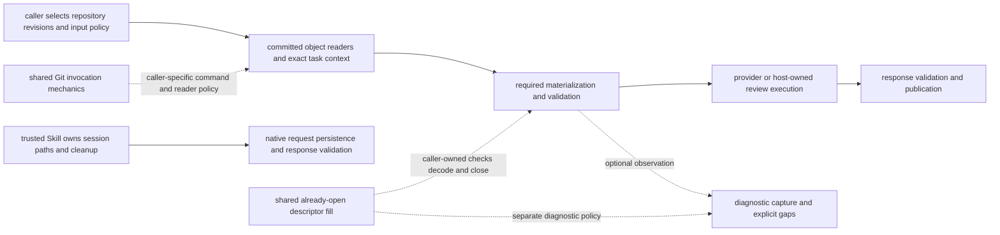

# Git/filesystem migration dispositions for #573

This non-normative checkpoint maps the implementation at adopted #616 `03da5c0f0da2c3f84427d084572aa14151ac6d09`, tree `5f99c3973583472909dd6683e568c775f967c907`. Inspection used the same-tree reviewed checkout `2aed63cfffa4802b7397abdff12df035fb74a505`. It joins source-only contract inventories with the separately verified mechanism increments. It changes no architecture, API, policy, runtime or assurance rule, and does not close #573.

## Implementation model and selected migrations

Edges describe responsibilities/dataflow, not a new execution route or observed host enforcement. Native adapter persistence does not dispatch the provider; trusted Skill execution owns that separate operation. Local lifecycle receipt/readback is also separate from protected hosted acceptance.

| Adopted increment | Shared mechanism and callers | Policy retained by callers |
| --- | --- | --- |
| #599 | Identical Git wrapper in the two merge-group scripts | Command, source, route, evidence and response selection; other materializer/gh/API processes are separate. |
| #604 | Four buffered Git invocation expressions across legacy snapshot, legacy CI preparation and single-member owner-addition operations | Existing 2,000,000-byte process buffer, inherited environment/cwd and native errors; callers retain commands, decoding and post-read limits. No timeout is added. |
| #615 | Current-position descriptor fill for diagnostic-path, measurement and Codex PASS input production | Opening, roots/paths, metadata, allocation, read accounting, limits, decoding/hashing, errors and closure. |
| #616 | Authority preparer uses the same fill loop; capacity diagnostic pins its helper dependency | Regular-file/sentinel/limit/label/decoder/close policy; exact old preparation compatibility without a generic missing-file fallback. |

These are mechanism reuse decisions, not interchangeable reader policies. The bounded Git library comparison supports retaining Node standard APIs plus the Git CLI for the selected synchronous byte/error contracts. Descriptor reuse also retains standard `readSync`; replacing it with whole-file acquisition would lose caller-owned capacity and per-positive-read accounting. No extra dependency or generic filesystem framework is selected.

## Census and method

The [per-path ledger](2026-10-18-io-migration-dispositions.json) contains every **73** path observed by the defined scan exactly once: **57 source paths** (56 with runtime imports and one type-only import) and **16 script paths**. TypeScript AST inspection selects static imports and literal `import()`/`require()` of `fs`, `fs/promises` and `child_process`, with optional `node:` prefix, in tracked authored `.mts`/`.mjs` under `src/` and `scripts/`. It separates type-only imports and observes calls through imported named/default/namespace bindings. It does not load the source.

This is a bounded syntactic census. Re-exports, computed loads, third-party internals, injected operations, global fetch, streams, environment/path accessors and inline YAML/action/shell I/O are not exhaustively selected. The supplemental surfaces below keep known examples visible. Counts describe the scan, not risk, defect detection, resource-boundary count or completion. The ledger records native import line/kind, current preservation disposition, rationale and source/reference links; detailed call facts remain in the linked inventories. A retention disposition preserves the named current contract and is not a claim that no future reuse is possible.

## Dispositions by family

Each scanned path appears once in this grouped map and once in the JSON ledger. Source links are immutable to the adopted baseline. Reference IDs resolve below; linked source reports retain their own scope/revision.

| Family and disposition | Scanned paths | Contract/reference |
| --- | --- | --- |
| CI report/PASS publication / `intentional-publication-protocol` | [src/ci-review/ci-report-entrypoint.mts](https://github.com/flair-agency/architecture-gatekeeper/blob/03da5c0f0da2c3f84427d084572aa14151ac6d09/src/ci-review/ci-report-entrypoint.mts) | Required input/report validation and workflow display sinks have separate producers and append/read protocols; retain the runner-owned output binding and exact report fields. R1, R5, R8 |
| Git process execution / `adopted-shared-mechanism` | [src/git/buffered-git.mts](https://github.com/flair-agency/architecture-gatekeeper/blob/03da5c0f0da2c3f84427d084572aa14151ac6d09/src/git/buffered-git.mts) | #604 centralizes one buffered Git invocation contract; it does not choose commands, repositories, decoding policy or reader semantics. R3 |
| PostToolUse durable state and snapshot / `intentional-lifecycle-contract` | [src/local-review/local-post-tool-screen.mts](https://github.com/flair-agency/architecture-gatekeeper/blob/03da5c0f0da2c3f84427d084572aa14151ac6d09/src/local-review/local-post-tool-screen.mts) | The hook owns tracked Git snapshots, state/identity reads via readFileSync, lease/marker lifetime, atomic state publication and cleanup; this durable coordination contract differs from provider scratch. R13, R7 |
| authority preparer descriptor read / `adopted-mechanism-retains-caller-contract` | [src/authority-validation/prepare-authority-set.mts](https://github.com/flair-agency/architecture-gatekeeper/blob/03da5c0f0da2c3f84427d084572aa14151ac6d09/src/authority-validation/prepare-authority-set.mts) | #616 reuses the loop but keeps preparer size checks, nonblocking open, regular-file validation, maxBytes+1 sentinel, decode order, labels and close ownership; preparer digest compatibility remains special. R2, R8 |
| descriptor byte-copy caller / `adopted-mechanism-retains-caller-contract` | [src/ci-review/codex-pass-producer.mts](https://github.com/flair-agency/architecture-gatekeeper/blob/03da5c0f0da2c3f84427d084572aa14151ac6d09/src/ci-review/codex-pass-producer.mts) [src/diagnostic-path.mts](https://github.com/flair-agency/architecture-gatekeeper/blob/03da5c0f0da2c3f84427d084572aa14151ac6d09/src/diagnostic-path.mts) [src/measurement.mts](https://github.com/flair-agency/architecture-gatekeeper/blob/03da5c0f0da2c3f84427d084572aa14151ac6d09/src/measurement.mts) | #615 reuses only the low-level descriptor read loop; Caller still owns open/stat/capacity/observer/decode/close order and its distinct output meaning. R1, R7, R9 |
| descriptor byte-copy primitive / `adopted-shared-mechanism` | [src/io/read-descriptor.mts](https://github.com/flair-agency/architecture-gatekeeper/blob/03da5c0f0da2c3f84427d084572aa14151ac6d09/src/io/read-descriptor.mts) | #615 supplies a loop over an already-open descriptor and caller buffer; it owns no open/close/stat/allocation/validation/decode/error translation. R1 |
| development/build/analysis tool / `tool-owning-resources` | [scripts/check-source-cycles.mjs](https://github.com/flair-agency/architecture-gatekeeper/blob/03da5c0f0da2c3f84427d084572aa14151ac6d09/scripts/check-source-cycles.mjs) [scripts/clean-dist.mjs](https://github.com/flair-agency/architecture-gatekeeper/blob/03da5c0f0da2c3f84427d084572aa14151ac6d09/scripts/clean-dist.mjs) [scripts/codeql-local.mjs](https://github.com/flair-agency/architecture-gatekeeper/blob/03da5c0f0da2c3f84427d084572aa14151ac6d09/scripts/codeql-local.mjs) [scripts/codeql-model-regression.mjs](https://github.com/flair-agency/architecture-gatekeeper/blob/03da5c0f0da2c3f84427d084572aa14151ac6d09/scripts/codeql-model-regression.mjs) | Each tool owns its source scan, generated CodeQL fixture/database/SARIF outputs, or fixed dist cleanup; its path, retention and delegated command contract are tool-specific. R0, R10 |
| fixed CI runner-temp boundary / `intentional-protocol-boundary` | [src/runner-paths/runner-temp-path.mts](https://github.com/flair-agency/architecture-gatekeeper/blob/03da5c0f0da2c3f84427d084572aa14151ac6d09/src/runner-paths/runner-temp-path.mts) | Fixed internal artifact selectors and actual workflow-output sink are distinct; retain runner cwd/temp binding and per-operation checks, not a universal path sanitizer. R0, R6, R8 |
| host ruleset readback / `intentional-observation-boundary` | [src/github/github-ruleset-readback-cli.mts](https://github.com/flair-agency/architecture-gatekeeper/blob/03da5c0f0da2c3f84427d084572aa14151ac6d09/src/github/github-ruleset-readback-cli.mts) [src/github/github-ruleset-readback.mts](https://github.com/flair-agency/architecture-gatekeeper/blob/03da5c0f0da2c3f84427d084572aa14151ac6d09/src/github/github-ruleset-readback.mts) | This route materializes/readbacks host observations with caller-specific paths; observation is not eligibility or acceptance, and no generic storage owner is selected. R0, R11 |
| hosted runtime relocation / `tool-owning-resources` | [scripts/relocate-protected-runtime.mjs](https://github.com/flair-agency/architecture-gatekeeper/blob/03da5c0f0da2c3f84427d084572aa14151ac6d09/scripts/relocate-protected-runtime.mjs) | This workflow operation validates and renames the pinned runtime checkout; Git cwd, runner temp, cleanup/rollback limitations are specific and not a generic path helper. R10 |
| injected GitHub CLI type boundary / `thin-delegating-native-boundary` | [src/github/github-cli-runner.mts](https://github.com/flair-agency/architecture-gatekeeper/blob/03da5c0f0da2c3f84427d084572aa14151ac6d09/src/github/github-cli-runner.mts) | The native child-process import is type-only and no direct operation is observed; runtime execution is supplied through callbacks, so this row is not itself a process sink. R0, R11 |
| injected process/callback caller / `retain-caller-owned-execution-adapter` | [src/ci-review/ci-procedural-authority-change.mts](https://github.com/flair-agency/architecture-gatekeeper/blob/03da5c0f0da2c3f84427d084572aa14151ac6d09/src/ci-review/ci-procedural-authority-change.mts) [src/ordinary-gemini-ci-workflow.mts](https://github.com/flair-agency/architecture-gatekeeper/blob/03da5c0f0da2c3f84427d084572aa14151ac6d09/src/ordinary-gemini-ci-workflow.mts) | These route modules pass an actual native executable into injected adapters; orchestration, repository/revision selection and failure handling remain caller-owned. An injected seam is not a thin guard or host proof. R11, R6, R7 |
| local/manual review composition / `intentional-caller-owned-contract` | [src/local-gate.mjs](https://github.com/flair-agency/architecture-gatekeeper/blob/03da5c0f0da2c3f84427d084572aa14151ac6d09/src/local-gate.mjs) [src/local-review/local-gate.mts](https://github.com/flair-agency/architecture-gatekeeper/blob/03da5c0f0da2c3f84427d084572aa14151ac6d09/src/local-review/local-gate.mts) | Preparation, optional measurement, reviewer selection and response validation remain with local adapters; an abort signal is cooperative and does not replace provider-owned process limits. R7, R9 |
| native session persistence / `preserve-current-host-owned-persistence` | [src/local-review/native-review.mts](https://github.com/flair-agency/architecture-gatekeeper/blob/03da5c0f0da2c3f84427d084572aa14151ac6d09/src/local-review/native-review.mts) [src/native-review.mjs](https://github.com/flair-agency/architecture-gatekeeper/blob/03da5c0f0da2c3f84427d084572aa14151ac6d09/src/native-review.mjs) | Native request/decision paths are caller/host-selected persistence handoffs, not runner-temp files; no #566 stream/persistence transfer is authorized by these inventories. R0, R7 |
| optional measurement/diagnostics / `reuse-deferred-retain-current-capture` | [src/measurement-ci.mts](https://github.com/flair-agency/architecture-gatekeeper/blob/03da5c0f0da2c3f84427d084572aa14151ac6d09/src/measurement-ci.mts) [src/measurement-cli.mts](https://github.com/flair-agency/architecture-gatekeeper/blob/03da5c0f0da2c3f84427d084572aa14151ac6d09/src/measurement-cli.mts) | Optional raw-byte metadata capture and gap outcomes do not share proven identity/timing with required request preparation; keep repeated root and committed-byte checks pending a same-capture handoff design. R7, R9 |
| owner-addition CI/finalization route / `intentional-route-specific-contract` | [src/owner-addition-ci.mjs](https://github.com/flair-agency/architecture-gatekeeper/blob/03da5c0f0da2c3f84427d084572aa14151ac6d09/src/owner-addition-ci.mjs) [src/owner-addition-finalize.mjs](https://github.com/flair-agency/architecture-gatekeeper/blob/03da5c0f0da2c3f84427d084572aa14151ac6d09/src/owner-addition-finalize.mjs) [src/owner-addition/finalize-owner-addition.mts](https://github.com/flair-agency/architecture-gatekeeper/blob/03da5c0f0da2c3f84427d084572aa14151ac6d09/src/owner-addition/finalize-owner-addition.mts) [src/owner-addition/owner-addition-multiauthority.mts](https://github.com/flair-agency/architecture-gatekeeper/blob/03da5c0f0da2c3f84427d084572aa14151ac6d09/src/owner-addition/owner-addition-multiauthority.mts) | Base/B snapshots, policy-selected inputs, procedure, output artifacts and single/multi-authority profiles have caller-specific rules; buffered Git only covers selected expressions. R3, R8 |
| owner-amendment handoff/evidence/tag route / `intentional-route-specific-contract` | [src/owner-amendment/owner-amendment-attestation.mts](https://github.com/flair-agency/architecture-gatekeeper/blob/03da5c0f0da2c3f84427d084572aa14151ac6d09/src/owner-amendment/owner-amendment-attestation.mts) [src/owner-amendment/owner-amendment-handoff-cli.mts](https://github.com/flair-agency/architecture-gatekeeper/blob/03da5c0f0da2c3f84427d084572aa14151ac6d09/src/owner-amendment/owner-amendment-handoff-cli.mts) [src/owner-amendment/owner-amendment-owner-decision-handoff-cli.mts](https://github.com/flair-agency/architecture-gatekeeper/blob/03da5c0f0da2c3f84427d084572aa14151ac6d09/src/owner-amendment/owner-amendment-owner-decision-handoff-cli.mts) [src/owner-amendment/owner-amendment-tag-readback.mts](https://github.com/flair-agency/architecture-gatekeeper/blob/03da5c0f0da2c3f84427d084572aa14151ac6d09/src/owner-amendment/owner-amendment-tag-readback.mts) | Injected Git/API/attestation boundaries, revision/profile checks and record/tag semantics differ by handoff or evidence operation; maintain separate adapter budgets and incomplete outcomes. R6 |
| owner-amendment merge-group route / `adopted-mechanism-retains-caller-contract` | [scripts/owner-amendment-merge-group-gate.mjs](https://github.com/flair-agency/architecture-gatekeeper/blob/03da5c0f0da2c3f84427d084572aa14151ac6d09/scripts/owner-amendment-merge-group-gate.mjs) | The shared runner covers explicit delegated Git calls only; materializer reads, tag/API/attestation I/O, route decision and temporary outputs retain separate owners and limits. R4, R6 |
| owner-amendment workflow producer/classifier / `intentional-route-specific-contract` | [scripts/owner-amendment-attempt-classifier.mjs](https://github.com/flair-agency/architecture-gatekeeper/blob/03da5c0f0da2c3f84427d084572aa14151ac6d09/scripts/owner-amendment-attempt-classifier.mjs) [scripts/owner-amendment-block-producer.mjs](https://github.com/flair-agency/architecture-gatekeeper/blob/03da5c0f0da2c3f84427d084572aa14151ac6d09/scripts/owner-amendment-block-producer.mjs) [scripts/owner-amendment-owner-decision-producer.mjs](https://github.com/flair-agency/architecture-gatekeeper/blob/03da5c0f0da2c3f84427d084572aa14151ac6d09/scripts/owner-amendment-owner-decision-producer.mjs) [scripts/owner-amendment-semantic-eligibility-producer.mjs](https://github.com/flair-agency/architecture-gatekeeper/blob/03da5c0f0da2c3f84427d084572aa14151ac6d09/scripts/owner-amendment-semantic-eligibility-producer.mjs) | These direct Git/GitHub/filesystem calls produce or classify route-specific provenance and records; keep workflow input, revision, output, attestation and failure ownership with that route. R0, R6, R8 |
| preview lifecycle runtime / `retain-distinct-observation-contract` | [src/preview-lifecycle-cli.mts](https://github.com/flair-agency/architecture-gatekeeper/blob/03da5c0f0da2c3f84427d084572aa14151ac6d09/src/preview-lifecycle-cli.mts) [src/preview-lifecycle-runtime.mts](https://github.com/flair-agency/architecture-gatekeeper/blob/03da5c0f0da2c3f84427d084572aa14151ac6d09/src/preview-lifecycle-runtime.mts) | Native Git/committed inputs, source/emitted byte identity and CLI receipt/readback remain local observation contracts with UNVERIFIED assurance; they are not the fixed runner-temp or diagnostic storage API. R0, R14 |
| provider execution and lifecycle / `intentional-provider-specific-contract` | [src/gemini-ci-runner.mjs](https://github.com/flair-agency/architecture-gatekeeper/blob/03da5c0f0da2c3f84427d084572aa14151ac6d09/src/gemini-ci-runner.mjs) [src/gemini-ci-runtime.mjs](https://github.com/flair-agency/architecture-gatekeeper/blob/03da5c0f0da2c3f84427d084572aa14151ac6d09/src/gemini-ci-runtime.mjs) [src/gemini-cli/ci-runner-entrypoint.mts](https://github.com/flair-agency/architecture-gatekeeper/blob/03da5c0f0da2c3f84427d084572aa14151ac6d09/src/gemini-cli/ci-runner-entrypoint.mts) [src/gemini-cli/gemini-cli-process.mts](https://github.com/flair-agency/architecture-gatekeeper/blob/03da5c0f0da2c3f84427d084572aa14151ac6d09/src/gemini-cli/gemini-cli-process.mts) [src/gemini-cli/gemini-cli-session.mts](https://github.com/flair-agency/architecture-gatekeeper/blob/03da5c0f0da2c3f84427d084572aa14151ac6d09/src/gemini-cli/gemini-cli-session.mts) [src/gemini-cli/launcher-entrypoint.mts](https://github.com/flair-agency/architecture-gatekeeper/blob/03da5c0f0da2c3f84427d084572aa14151ac6d09/src/gemini-cli/launcher-entrypoint.mts) [src/gemini-launcher.mjs](https://github.com/flair-agency/architecture-gatekeeper/blob/03da5c0f0da2c3f84427d084572aa14151ac6d09/src/gemini-launcher.mjs) [src/ordinary-gemini-ci-adapter.mjs](https://github.com/flair-agency/architecture-gatekeeper/blob/03da5c0f0da2c3f84427d084572aa14151ac6d09/src/ordinary-gemini-ci-adapter.mjs) [src/ordinary-gemini-ci-publication.mts](https://github.com/flair-agency/architecture-gatekeeper/blob/03da5c0f0da2c3f84427d084572aa14151ac6d09/src/ordinary-gemini-ci-publication.mts) [src/reviewer-transports/codex-transport.mts](https://github.com/flair-agency/architecture-gatekeeper/blob/03da5c0f0da2c3f84427d084572aa14151ac6d09/src/reviewer-transports/codex-transport.mts) [src/reviewer-transports/gemini-transport.mts](https://github.com/flair-agency/architecture-gatekeeper/blob/03da5c0f0da2c3f84427d084572aa14151ac6d09/src/reviewer-transports/gemini-transport.mts) | Codex synchronous temp/process ownership, Gemini HTTP fetch/deadline, Gemini CLI workspace/private-HOME/process-group/proxy and CI output persistence differ; retain each adapter and lifetime. R7, R8 |
| release workflow helper / `tool-owning-resources` | [scripts/release-channel.mjs](https://github.com/flair-agency/architecture-gatekeeper/blob/03da5c0f0da2c3f84427d084572aa14151ac6d09/scripts/release-channel.mjs) | Consumes caller-provided environment and checkout context, emits workflow values; registry readback values are supplied by caller, not acquired by this script. R10, R8 |
| required CI authority/review input / `intentional-required-input-contract` | [src/authority-validation/authority-set.mts](https://github.com/flair-agency/architecture-gatekeeper/blob/03da5c0f0da2c3f84427d084572aa14151ac6d09/src/authority-validation/authority-set.mts) [src/preflight-authority-set-review.mjs](https://github.com/flair-agency/architecture-gatekeeper/blob/03da5c0f0da2c3f84427d084572aa14151ac6d09/src/preflight-authority-set-review.mjs) [src/prepare-authority-set.mjs](https://github.com/flair-agency/architecture-gatekeeper/blob/03da5c0f0da2c3f84427d084572aa14151ac6d09/src/prepare-authority-set.mjs) [src/prepare-protected-ci-input.mjs](https://github.com/flair-agency/architecture-gatekeeper/blob/03da5c0f0da2c3f84427d084572aa14151ac6d09/src/prepare-protected-ci-input.mjs) [src/prepare-review-context.mjs](https://github.com/flair-agency/architecture-gatekeeper/blob/03da5c0f0da2c3f84427d084572aa14151ac6d09/src/prepare-review-context.mjs) [src/resolve-ci-policy.mjs](https://github.com/flair-agency/architecture-gatekeeper/blob/03da5c0f0da2c3f84427d084572aa14151ac6d09/src/resolve-ci-policy.mjs) [src/validate-authority-set-decision.mjs](https://github.com/flair-agency/architecture-gatekeeper/blob/03da5c0f0da2c3f84427d084572aa14151ac6d09/src/validate-authority-set-decision.mjs) [src/validate-decision.mjs](https://github.com/flair-agency/architecture-gatekeeper/blob/03da5c0f0da2c3f84427d084572aa14151ac6d09/src/validate-decision.mjs) | These are required policy/review preparation and validation boundaries; preserve exact revision, byte/mode, decode, size/deadline, output and failure distinctions rather than adopting optional diagnostic rules. R0, R5, R8 |
| required local request preparation / `reuse-deferred-retain-current-capture` | [src/review-contract/review-contract.mts](https://github.com/flair-agency/architecture-gatekeeper/blob/03da5c0f0da2c3f84427d084572aa14151ac6d09/src/review-contract/review-contract.mts) | Required parsed/decoded inputs and optional raw committed-byte digest capture differ in source bytes, reader/decode contract and phase; do not substitute request values or prior root identity. R9 |
| review materialization/workspace / `intentional-required-input-contract` | [src/review-inputs/materialize-regular-git-snapshot.mts](https://github.com/flair-agency/architecture-gatekeeper/blob/03da5c0f0da2c3f84427d084572aa14151ac6d09/src/review-inputs/materialize-regular-git-snapshot.mts) [src/review-inputs/materialize-review-workspace.mts](https://github.com/flair-agency/architecture-gatekeeper/blob/03da5c0f0da2c3f84427d084572aa14151ac6d09/src/review-inputs/materialize-review-workspace.mts) [src/review-inputs/prepare-review-context.mts](https://github.com/flair-agency/architecture-gatekeeper/blob/03da5c0f0da2c3f84427d084572aa14151ac6d09/src/review-inputs/prepare-review-context.mts) [src/review-inputs/prepare-review-file-context.mts](https://github.com/flair-agency/architecture-gatekeeper/blob/03da5c0f0da2c3f84427d084572aa14151ac6d09/src/review-inputs/prepare-review-file-context.mts) [src/review-inputs/review-input-path.mts](https://github.com/flair-agency/architecture-gatekeeper/blob/03da5c0f0da2c3f84427d084572aa14151ac6d09/src/review-inputs/review-input-path.mts) | Git object materialization, review-file selection and workspace create/cleanup boundaries have separate readers and owners; preserve request limits and cleanup ownership. R5, R7, R8 |
| review-capacity diagnostic / `separately-reviewed-tool-contract` | [scripts/review-capacity.mjs](https://github.com/flair-agency/architecture-gatekeeper/blob/03da5c0f0da2c3f84427d084572aa14151ac6d09/scripts/review-capacity.mjs) | Retain the dedicated capacity format, exact base/candidate inputs and output behavior; this index does not repeat its independent runner/format analysis or treat it as general filesystem API. R0, R11 |
| test-only historical probe / `probe-owning-resources` | [scripts/issue83-block-record-probe.mjs](https://github.com/flair-agency/architecture-gatekeeper/blob/03da5c0f0da2c3f84427d084572aa14151ac6d09/scripts/issue83-block-record-probe.mjs) [scripts/issue83-offline-block-verifier.mjs](https://github.com/flair-agency/architecture-gatekeeper/blob/03da5c0f0da2c3f84427d084572aa14151ac6d09/scripts/issue83-offline-block-verifier.mjs) [scripts/issue83-real-pr-block-probe.mjs](https://github.com/flair-agency/architecture-gatekeeper/blob/03da5c0f0da2c3f84427d084572aa14151ac6d09/scripts/issue83-real-pr-block-probe.mjs) | Inputs, external Git/GitHub calls (for verifier/probe variants), bounded parsing, output and temp lifetime belong to the explicitly invoked experiment; results are not acceptance evidence. R0, R10 |
| workflow Git process boundary / `adopted-shared-mechanism` | [scripts/owner-amendment-merge-group-git.mjs](https://github.com/flair-agency/architecture-gatekeeper/blob/03da5c0f0da2c3f84427d084572aa14151ac6d09/scripts/owner-amendment-merge-group-git.mjs) | #599 factors the identical Git invocation options for two CLIs; ordered argv, cwd binding, buffer/deadline and process exceptions remain explicit. R4 |
| workflow output append / `intentional-protocol-boundary` | [src/ci-decision-kind.mjs](https://github.com/flair-agency/architecture-gatekeeper/blob/03da5c0f0da2c3f84427d084572aa14151ac6d09/src/ci-decision-kind.mjs) [src/ci-procedural-authority-change.mjs](https://github.com/flair-agency/architecture-gatekeeper/blob/03da5c0f0da2c3f84427d084572aa14151ac6d09/src/ci-procedural-authority-change.mjs) | Append-only workflow command output is a distinct caller-created sink and protocol; keep its exact path acquisition and append behavior, not a generic file writer. R0, R8 |

## Supplemental surfaces and capture reuse

The three #604 caller modules and the ordinary merge-group CLI no longer need direct native imports for their delegated Git operations. They remain callers, not removed I/O boundaries. The ledger separately lists mediated amendment Git/evidence APIs, path-source accessors, workflow shell/action surfaces and HTTP/global-fetch examples outside the scan filter. The ordinary and remaining CI reports distinguish helper-owned member reads, shell staging, explicit Git/gh commands, action-owned transport and enclosing job/step timeouts. No universal child deadline or successful-file cleanup is inferred.

Optional metadata reuse remains deferred. The required request carries decoded/parsed settings and, for v2, authority manifest/member digests; it does not carry the raw config/reviewer/validation blob digests acquired by measurement. Validation timing, request-time repository verification and optional acquisition/gap behavior differ. The eight implementation files named by that #615 assessment are byte-identical at #616; this is source continuity, not a new performance or live-host proof. Revisit only with a concrete cost and same-root/revision/raw-byte handoff plus equivalence and acquisition-count evidence.

Existing native request/decision paths remain the canonical trusted-host session handoff. #566's proposed stream/persistence responsibility transfer remains unapproved. Provider scratch, private HOME/workspace, process supervision, PostToolUse durable state/lease, fixed CI artifacts and workflow outputs retain distinct lifetimes and error contracts. Preview prepare/complete/local readback keeps its separate UNVERIFIED assurance; local OBSERVED/VERIFIED fields do not activate or prove hosted adoption.

## Explicit follow-up and verification scope

- Further comparison candidates include the two handoff CLI native Git adapters and the historical offline verifier's local descriptor reader. This index does not establish their full mechanism equivalence or select an extraction; compare actual buffer/timeout, script/runtime compatibility, error, decoding and cleanup first. Small identical expressions alone do not justify a new abstraction. They remain tracked under #573.
- Shell manifest staging followed by bounded helper reread, and repeated OWNER_DECISION Git-change/blob calculations, are recorded explicitly. Do not remove a reread without preserving the producer/consumer and immutable capture bindings. New acquisition or persistence responsibility requires separate design and any applicable canonical owner decision; routine source comparison is not automatically owner-blocked.
- The ledger is not a complete transitive call graph or every external caller/action implementation. Additional unestablished contracts remain follow-up. Required validation stays fail-closed and optional diagnostics stay non-accepting; source inspection does not establish actual host cleanup, sandbox enforcement, custody or race freedom.
- Each adopted mechanism PR retains its own focused/full/distribution/detection/independent/Native/hosted/protected evidence and limitations. This documentation checkpoint adds source synthesis, not another execution result, risk disposition or whole #573/#254 completion. Existing #569/#572 questions and consumer/live lifecycle/release obligations keep their owners.

## Source records

- R0 — [Initial Git/filesystem responsibility inventory](https://github.com/flair-agency/architecture-gatekeeper/blob/03da5c0f0da2c3f84427d084572aa14151ac6d09/docs/investigations/2026-10-18-git-filesystem-responsibility-inventory.md). historical, non-normative source map; its own text says not exhaustive
- R1 — [Shared descriptor read mechanism (#615)](https://github.com/flair-agency/architecture-gatekeeper/blob/03da5c0f0da2c3f84427d084572aa14151ac6d09/docs/investigations/2026-10-18-descriptor-read-mechanism.md). adopted mechanism note; caller policies retained; package/runtime/acceptance limits stated there
- R2 — [Authority preparer descriptor reuse (#616)](https://github.com/flair-agency/architecture-gatekeeper/blob/03da5c0f0da2c3f84427d084572aa14151ac6d09/docs/investigations/2026-10-18-preparer-descriptor-read.md). adopted preparer-specific reuse note; preserves pinned preparation behavior; distribution checks are separate
- R3 — [Buffered Git process boundary (#604)](https://github.com/flair-agency/architecture-gatekeeper/blob/03da5c0f0da2c3f84427d084572aa14151ac6d09/docs/investigations/2026-10-18-buffered-git-process-boundary.md). adopted bounded process helper with distinct caller policies; broader #573 remains partial
- R4 — [Merge-group Git wrapper extraction (#599)](https://github.com/flair-agency/architecture-gatekeeper/blob/03da5c0f0da2c3f84427d084572aa14151ac6d09/docs/investigations/2026-10-18-merge-group-git-wrapper-extraction.md). adopted wrapper-only consolidation; commands and route policies remain caller-owned
- R5 — [Ordinary self-CI I/O inventory](https://github.com/flair-agency/architecture-gatekeeper/issues/573#issuecomment-6248905083). corrected report has bounded independent source-accuracy reread; review binds older source snapshot, not whole #573 acceptance
- R6 — [Mediated owner-amendment I/O inventory](https://github.com/flair-agency/architecture-gatekeeper/issues/573#issuecomment-6249192074). current-tree source report with bounded independent source-accuracy reread; review is limited to source accuracy
- R7 — [Provider, hook, and native I/O inventory](https://github.com/flair-agency/architecture-gatekeeper/issues/573#issuecomment-6249300313). Source-only current-tree contract inventory; independent final source-accuracy reread passed. Existing canonical host-session ownership and pending #566 transfer are distinct.
- R8 — [Remaining CI workflow I/O inventory](https://github.com/flair-agency/architecture-gatekeeper/issues/573#issuecomment-6249302102). Source-only current-tree workflow contract inventory; independent final source-accuracy reread passed; job/step/native subprocess budgets remain distinct.
- R9 — [Metadata reuse follow-up assessment](https://github.com/flair-agency/architecture-gatekeeper/issues/573#issuecomment-6248933065). Source-only metadata reuse assessment at #615. Its eight named implementation files are byte-identical between #615 and #616; no reuse or new performance proof is inferred.
- R10 — [Developer, release, and probe I/O inventory](https://github.com/flair-agency/architecture-gatekeeper/issues/573#issuecomment-6249303947). Source-only current-tree developer/release/probe inventory; independent final source-accuracy reread passed; no probe execution authorized.
- R11 — [Native import scan](2026-10-18-io-migration-dispositions.md#census-and-method). Defined AST import census for the source revision in this index; not transitive or workflow completeness.
- R12 — [Bounded Git mechanism and library comparison](https://github.com/flair-agency/architecture-gatekeeper/issues/573#issuecomment-6244661083). Exact-version comparison for selected synchronous buffered Git callers; not a universal library choice.
- R13 — [Direct filesystem ownership inventory](https://github.com/flair-agency/architecture-gatekeeper/issues/573#issuecomment-6244660289). Historical #604 source inventory; selected descriptor callers were subsequently migrated in #615/#616.
- R14 — [Preview lifecycle I/O inventory](https://github.com/flair-agency/architecture-gatekeeper/issues/573#issuecomment-6249338730). Source-only current-tree inventory; independent final source-accuracy reread passed; local observation retains UNVERIFIED assurance.
